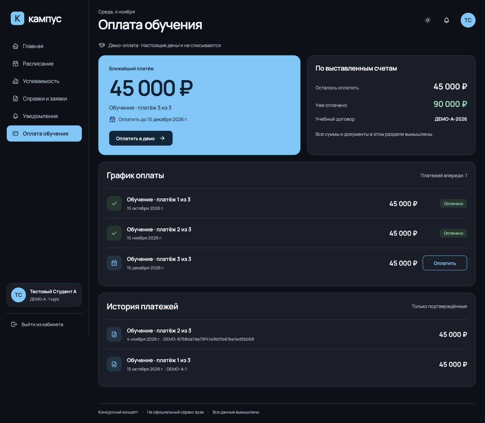

# Опубликованное демо — обновление 05.11.2026

[Открыть «Кампус»](https://student-portal-hackathon.ankajournal-cloudflare.workers.dev).

По прямому поручению пользователя опубликован main
`b0ed35e5eea15939c2dd6521e4224d65da86d5db`, включающий одобренный Артёмом
и объединённый PR #18. Worker `student-portal-hackathon`, версия
`8f06f30f-6444-458a-8728-5922a5f03a3a`, 100% текущего выпуска.
Адрес, конфигурация Worker, схема Supabase и демо-данные сохранены.

Выпуск исправляет поздние ответы и повторные отказы истории заявок,
закрытие ожидающей оплаты и видимость её позднего отказа со сверкой счетов,
а также обновление московской даты. [Проверки исправлений](audit-fixes.md).

Перед отправкой выполнены production build и Wrangler dry-run; сборка
совпадает по исходникам с проверенными 30 тестами и успешным CI PR #18.
Приватных ключей и демо-паролей в assets не найдено. Известное предупреждение
сборки: общий JS-файл чуть более 500 kB; сборка завершилась успешно.
HTML, JS, CSS и шрифт получены по HTTPS и побайтно совпали с dist;
SPA fallback также проверен. [SHA256 и версия](releases/2026-11-05-assets.json).

После обновления прошли **17 браузерных проверок настоящего HTTPS сайта
и Supabase без фикстур**: вход/выход A/B, недельное расписание, актуальная
московская дата, два долга A и отсутствие долгов B, история заявок,
отмена оплаты через Escape, договоры A/B, оплаченная история B, уведомления,
профиль через мобильное меню и отсутствие переполнения при 360 px в двух темах.
[Протокол](releases/2026-11-05-browser.json).

Новые заявки и платежи не отправлялись; прочтение уведомлений не менялось.
У A сохранён платёж 3 для демонстрации (45 000 ₽), у B всё оплачено.
Постоянные сетевые отказы и переход полуночи были проверены локально до
выпуска; на публичном origin эти условия не воспроизводились. Физический
телефон и скринридер не проверены. Предыдущая версия для возможного отката —
`00f38c34-3d5e-4913-950e-8b2ab5205ae0`; откат фронтенда не меняет данные Supabase.

---

# Предыдущий выпуск — 04.11.2026

[Открыть «Кампус»](https://student-portal-hackathon.ankajournal-cloudflare.workers.dev).

Демонстрационная сборка ветки feat/skyzixss-tuition-backend (#16),
продуктовый код cd5ffa2069d833a619bb36cd19c05fc195c32e07.
Она содержит интерфейс #13/#14, общую серверную интеграцию и исправленный CI.
На момент этого выпуска PR ещё не были объединены; впоследствии #12–#16
объединены, а 05.11.2026 после review принят #18.

Cloudflare Worker: student-portal-hackathon, Static Assets без собственных
динамических обработчиков, банковских интеграций и серверных секретов.
Версия 00f38c34-3d5e-4913-950e-8b2ab5205ae0. Существующий workers.dev subdomain
сохранён; чужие Worker, маршруты и настройки аккаунта не менялись.
Платные тарифы не включались. Запросы к статическим assets бесплатны согласно
[документации Cloudflare](https://developers.cloudflare.com/workers/static-assets/billing-and-limitations/).

Перед публикацией прошли build, dry-run, проверка отсутствия admin-ключа и
демо-паролей в assets. После публикации index.html, JS, CSS и шрифт повторно
получены по HTTPS и побайтно совпали с локальной сборкой. SPA fallback для
/demo-route вернул рабочий index. [Версия и SHA-256](tuition/deployment.json).

## Проверки опубликованного приложения

22 целевые браузерные проверки через настоящий HTTPS сайт и Supabase,
без HTTP-фикстур: [протокол](tuition/public-browser.json).

- Вход A/B прежними паролями, неправильный пароль и выход без личных данных.
- Профиль через карточку в мобильном меню, расписание недели, фильтр двух
  долгов A и отсутствие долгов у B.
- Создание заявки с телефона, сохранение после reload/relogin, новое личное
  уведомление и сохранение прочтения; B не видит заявку A.
- Демо-счета A с настоящего сервера, отмена по Escape, подтверждение оплаты,
  изменение остатка/истории, сохранение после reload/relogin.
- B: свой договор и три ранее оплаченных счёта, нет договора A.
- 360 px в обеих темах и 1440 px без обнаруженного переполнения.

В браузере один вымышленный счёт A (платёж 2 из 3) отмечен оплаченным.
Платёж 3 оставлен неоплаченным для следующего показа; остаток A теперь
45 000 ₽, B — 0 ₽. История не сбрасывалась. Созданы одна новая вымышленная
заявка A и её личное уведомление. Настоящие деньги не списывались.

Дополнительно прошли 38 реальных Auth/REST проверок оплаты на отдельных
временных счетах ([протокол](tuition/live-auth.json)), общий PostgreSQL-набор
с 66 базовыми RLS и правами/конкурентной оплатой, 22 unit-теста и TypeScript.
CI #15 (20 тестов) и CI #16 (22 теста, сборка и расширенный PostgreSQL) прошли.

## Ограничения и передача

Сервис предназначен только для вымышленных конкурсных данных. Обработки
заявок сотрудником и настоящей оплаты нет. Регистрация закрыта. Пароли
и привилегированные ключи остаются в ignored локальной конфигурации,
в отчётах и GitHub их нет. JWT/Free и два предупреждения Supabase описаны
в [architecture.md](architecture.md). Физический телефон, скринридер и
новый сценарий сетевого отказа на публичном origin не проверены.

04.11.2026 Artem545111 одобрил #15 и #16 после независимой проверки;
по поручению пользователя они объединены squash в ветки #13 и #14.
Отчёты обоих PR сохранены; ветка #14 обновлена из #13 с согласованием
документации о 22 тестах и уже опубликованном демо.
Историческая последовательность интеграции #12 → #13 → #14 уже завершена.
#10/#11 закрыты как включённые в интеграцию; повторно объединять их не нужно.
Auto-merge не включался.

После следующих изменений собирать заново и публиковать только проверенные
assets; новая версия Cloudflare и её проверки должны отражаться в отчёте.
Откат фронтенда не откатывает Supabase-схему и демо-историю.

