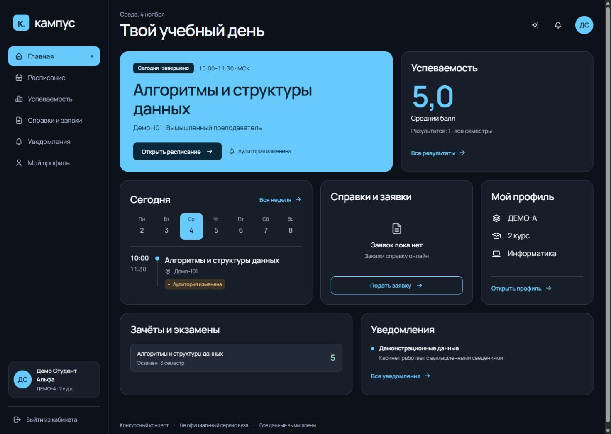
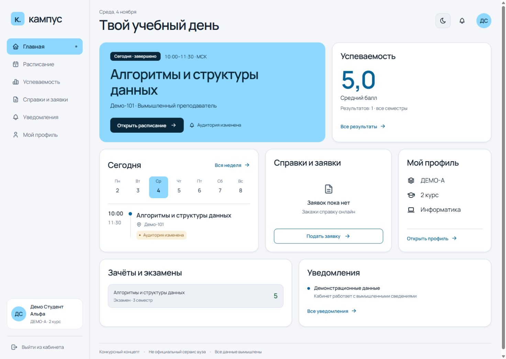

# Кампус: голубой акцент, две темы

Направление выбрано пользователем: объединённый тёмный эскиз по присланному
референсу, затем добавлена светлая версия с переключателем. Это адаптация
утверждённой композиции к работающему кабинету, а не растровый экран.

- Продукт: личный кабинет, чтобы студент видел учёбу и решал вопросы деканата.
- Характер: собранный, прямой, энергичный.
- Мир: студенческий ежедневник и навигация по кампусу.
- Акцент: голубая карточка фактического сегодняшнего занятия.
- Деталь: временная линия занятий и полоса дней недели.

[Выбранный эскиз](design/reference.webp) · [Тёмная версия](design/dark-desktop.webp) ·
[Светлая версия](design/light-desktop.webp) · [Сравнение](design/comparison-final.webp)

## Девять проходов

1. Отступы: шаг 4 px, поля 24–32 px, сетка разной ширины, одинаковые внутренние
   отступы карточек. Мобильная версия перестраивается в одну колонку.
2. Цвет: нейтральные графитовые/светлые поверхности, голубая пара, отдельные
   семантические цвета ошибок, изменений и результатов. Без свечения и градиентов.
3. Иконки: оригинальные outline SVG Tabler, локально, без нового пакета; одна
   толщина набора. Декоративные искры убраны, фирменный знак «К» выровнен по центру без точки.
4. Текст: «Привет, имя. Твой учебный день» из профиля студента, реальные предметы, аудитории, статусы. Нет XP,
   серий посещения, рейтинга потока и выдуманных дедлайнов: API их не содержит.
5. Шрифт: Manrope с кириллицей, локальный variable TTF; подписи от 12 px,
   основные данные от 14–16 px, табличные цифры. Заголовок пары 40/32 px.
6. Композиция: пара + успеваемость, затем расширенное расписание/профиль, ниже результаты
   и уведомления. Все карточки читают сервер через общий API; данные загружаются
   независимо, ошибка одного раздела не превращается в подставной ноль.
7. Детали: состояния загрузки, ошибки, повтора, отсутствия данных; читаемые
   изменения аудитории, состояния ссылок/кнопок, контраст и видимый фокус.
8. Визуалы: вместо маркетингового баннера — само занятие; фон не маскирует
   отсутствующие данные. Эскиз ImageGen использован как цель, в сайт не вставлен.
   Новых изображений при реализации не генерировалось.
9. Движение: вход раздела/дня, открытие меню, отклик действий и смена цветов
   темы. Без пульсаций и фоновых циклов; reduced-motion отключает движение.

## Темы и доступность

На первом посещении используется тема системы, явный выбор хранится между
посещениями. Шапка, форма входа, расписание, оценки, профиль, заявки и
уведомления используют одну тему. Семантические цвета модулей #5 привязаны
к явному выбору, даже если тема ОС другая.

Минимальный измеренный контраст восьми основных пар: **7,43:1** в тёмной и
**5,59:1** в светлой теме. Это проверка токенов текста/поверхности/акцента/
семантических состояний, не заявление об автоматическом полном WCAG-аудите.
Есть 44 px кнопки, видимый фокус, доступные подписи и модальное меню.
Дни календаря на узком экране остаются в общей семидневной полосе.

[Телефон: тёмная](design/dark-mobile.webp) · [светлая](design/light-mobile.webp) ·
[меню](design/dark-mobile-menu.webp) · [отправленная заявка](design/light-request-mobile.webp)

## Источники и процесс ИИ

Manrope взят из [Google Fonts](https://github.com/google/fonts/tree/main/ofl/manrope),
Tabler — из [официального репозитория](https://github.com/tabler/tabler-icons).
Ресурсы локальные, лицензии и точные версии сохранены в
[src/styles/ASSETS.md](../src/styles/ASSETS.md). Внешние CDN не используются.
Официальной символики вуза нет.

Пользователь выбрал направление и эскиз, агент перевёл их в компоненты,
проверил состояния API, исправил при сравнении конфликт размера заголовка,
высоту профиля и мобильное переполнение. [QA с исходным и итоговым
экраном](../design-qa.md) фиксирует изменения и ограничения.

Методика unslop: Damir Sokolovsky ([@heydamir](https://x.com/heydamir)),
[unslop](https://github.com/heydamir/unslop), CC BY 4.0. Девять проходов
адаптированы под существующий React-проект и утверждённый дизайн.

## Правки по аннотациям пользователя

Убрана точка в активном пункте навигации, знак «К» без точки центрирован
нулевым межбуквенным интервалом. Заголовок главной заменён на «Привет, имя. Твой учебный день».
Пока профиль загружается, отображается «Твой учебный день»; имя берётся из первого
слова full_name текущего студента. Другие разделы сохраняют свои названия.
Предыдущие снимки выше фиксируют исходную итерацию до этих трёх правок.

## Главная с акцентом на расписании

По запросу пользователя карточка справок и заявлений убрана с главной.
Расписание занимает 9 из 12 колонок на широком экране, а при ширине до
1200 px — всю строку. В занятии видны и аудитория, и преподаватель.
Заявки доступны отдельным пунктом меню; главная больше не запрашивает их
список у API. Проверены 360, 1069 и 1440 px, смена дня и вход в раздел заявок.

[Актуальная главная с расширенным расписанием](design/expanded-schedule.webp)
