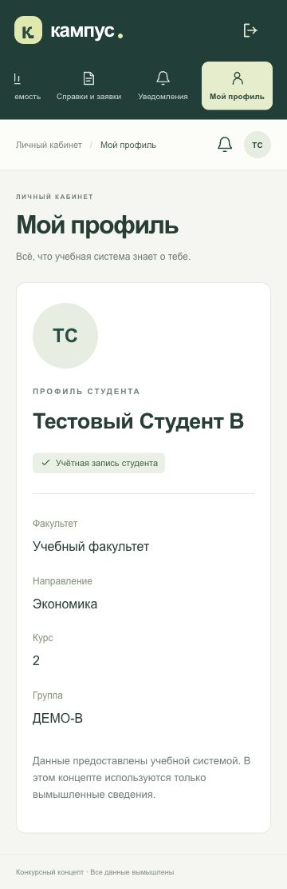
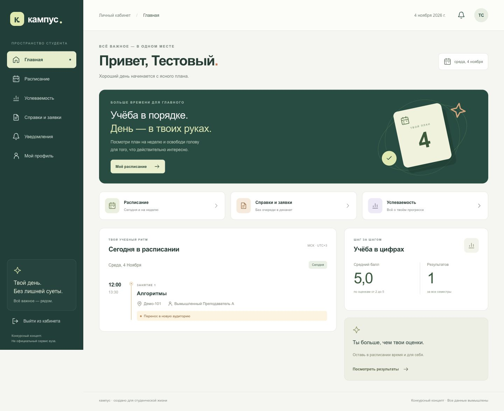

# Интеграция портала — 04.11.2026

Ветка: feat/skyzixss-portal-integration. Основа main 8067d2e, интерфейс
Артёма abe597f (PR #10), заявки/уведомления PUPSIK359 df4b2b2 (Issue #5).
Ветки участников не переписывались; их коммиты объединены обычными merge.

## Что сделано владельцем #4

Добавлены npm scripts dev/build/preview. Общий npm test теперь включает
12 unit-тестов: серверный клиент, live-assertions, ошибки UI, даты и заявки.
В CI добавлена production сборка. Новых зависимостей не потребовалось.

Shell автоматически обнаружил оба Panel через согласованные пути; менять
файлы участников для подключения не потребовалось. Конфликтов merge нет.

## Реальная проверка в браузере

Локальный Vite обращался непосредственно к облачному Supabase демо-проекту.
HTTP-фикстуры и тестовые подмены SDK не использовались. Пароли читались из
ignored локального файла, в отчёт/репозиторий не включены.

21 проверка выполнена через браузер: [машинный отчёт](integration/live-browser.json).

- Вход A: настоящее расписание, профиль и перенос.
- Подача заявки, сохранение после перезагрузки и повторного входа.
- Количество серверных уведомлений увеличивается ровно на одно;
  отметка прочтения сохраняется после перезагрузки.
- На 360 px заявка отправляется клавишей Enter, форма и профиль не вызывают
  горизонтального переполнения страницы.
- Выход скрывает данные A. Вход B показывает другое расписание/профиль/оценки;
  обе новые заявки A отсутствуют в списке B.
- B создаёт свою заявку; после повторного входа A она у A не отображается,
  а его собственные заявки сохранены.
- Неверный пароль даёт видимую ошибку вместо входа в кабинет.
- При ширине 1440 px главная не имеет горизонтального переполнения.

Облачная серверная проверка 55 Auth/REST сценариев уже выполнена в PR #8;
этот браузерный прогон дополнительно проверяет собранный интерфейс.

## Проверки сборки

npm run check, npm test (12/12), npm run build — успешны.
wrangler deploy --dry-run — успешен, загрузки/развёртывания сайта не было.
Сборка проверена на отсутствие admin-ключа и паролей тестовых аккаунтов.

## Ограничения

Попытка offline-эмуляции не заблокировала запрос к Supabase: тестовая заявка
реально сохранилась. Поэтому поведение формы при потере сети этим live-прогоном
не подтверждено. Настройка сети восстановлена. Отдельные тесты классификации
ошибок и fixture-проверки автора не заменяют такую live-проверку.

Сайт не опубликован. Обработка заявок деканатом пока отсутствует и честно
обозначена в UI. Supabase Free ограничен, предупреждение о leaked-password
защите и срок действия старого JWT после выхода описаны в architecture.md.

## Снимки реального демо

На снимках только вымышленные студенты из нашего облачного проекта.

