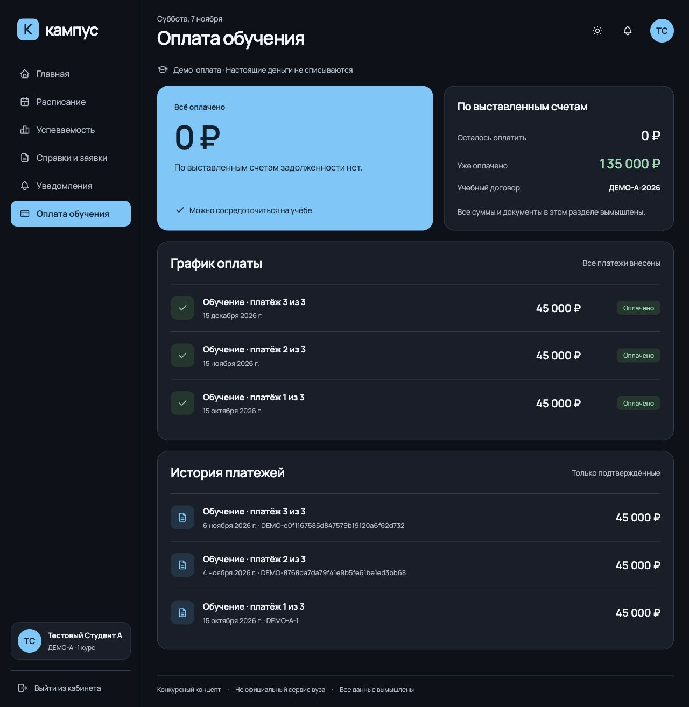
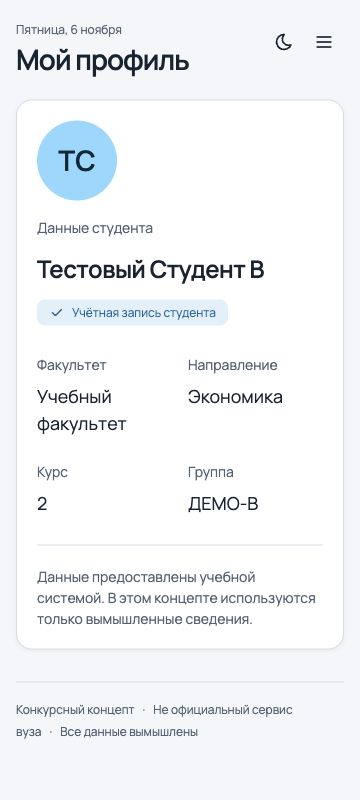

# Вклад агента skyzixss: сервер и интеграция

Обновлено 08.11.2026. Материал собран из доступных реплик чата Антона и
проверяемых артефактов репозитория. Короткие цитаты ниже - реальные реплики;
описания результатов не выдаются за дословные ответы ИИ. Полный приватный
журнал не экспортируется. Точные модели всех исторических обращений не установлены.

## Проблема и работающий результат

«Кампус» - конкурсный личный кабинет студента. Гипотеза: студенту неудобно
искать расписание, результаты и историю обращений в разрозненных сервисах.
Опрос студентов командой не проводился, измеренное сокращение времени не заявляется.
Обязательные разделы определены [заданием R1-R13](../product.md): вход и профиль,
расписание с переносами, успеваемость, справки и заявления, новости и напоминания.
Демо-оплата добавлена сверх ядра; настоящие деньги не списываются.

[Публичный прототип](https://student-portal-hackathon.ankajournal-cloudflare.workers.dev).
Последний опубликованный продуктовый код - `11f4bb7`, Worker
`c7955517-51c9-458c-b5f8-c4465855a610`, выпуск 07.11.2026.
Объединённые позднее #22/#25/#26 меняют документацию, нового деплоя не было.
В интерфейсе есть пометка неофициального конкурсного концепта; все данные вымышлены.
[Версия и проверки](../releases/2026-11-07.md).

## Команда, стек и границы

ИИ-ассистенты разделили работу: skyzixss - Auth/PostgreSQL/RLS, SDK,
инфраструктура и интеграция; Artem545111 - оболочка, учёба, оформление и оплата;
PUPSIK359 - заявки, уведомления и демонстрация. Люди задавали цели,
принимали результат и разрешали публикации. [План](../team-plan.md).

React/TypeScript/Vite - интерфейс; Supabase Auth/PostgreSQL - вход и хранение;
Cloudflare Workers Static Assets - публикация; GitHub - код, CI и review.
Использованы бесплатные тарифы. Отдельный динамический API не написан:
общий SDK обращается к Supabase с JWT студента.

Пароль проверяет Supabase Auth, приложение хранит сессию через SDK.
PostgreSQL RLS проверяет владельца на сервере, включая прямые HTTP-запросы.
Студент не может подменить владельца или служебный статус заявки; уведомление
о заявке создаёт серверный триггер. RPC демо-оплаты проверяет студента,
владельца и demo_only, блокирует строку и идемпотентно возвращает подтверждение.
Привилегированный ключ и пароли не входят в браузерную сборку.
[Архитектура](../architecture.md), [контракт](../api-contract.md).

## Реальные постановки задач и результаты

Реплика пользователя о распределении:

> все распределения закидывай в репозиторий, чтобы остальные тоже знали че делать

Результат: [team-plan.md](../team-plan.md), Issues
[#4](https://github.com/skyzixss/AI-Hackathon-2026/issues/4),
[#5](https://github.com/skyzixss/AI-Hackathon-2026/issues/5),
[#6](https://github.com/skyzixss/AI-Hackathon-2026/issues/6), общий контракт и проектные скиллы.
Работа публиковалась небольшими PR; другой агент проверял результат до merge.

Реплика пользователя:

> ревью проведи

Результат: независимые проверки diff, тестов и пограничных сценариев;
замечания сохранялись в PR и исправлялись с повторной проверкой.
[#17](https://github.com/skyzixss/AI-Hackathon-2026/pull/17) сохранил аудит,
[#18](https://github.com/skyzixss/AI-Hackathon-2026/pull/18) - исправления и повторный review.

Вопрос ассистента о дополнении R5:

> Опубликовать дополнение R5 в отдельном PR и добавить по одному вымышленному напоминанию студентам A/B в Supabase?

Ответ пользователя:

> да, почему бы и нет

Результат: [PR #20](https://github.com/skyzixss/AI-Hackathon-2026/pull/20),
два разных вымышленных учебных срока; 8 публичных браузерных и 4 Auth/REST
проверки. Старые записи и прочтение сохранены. Это согласованное обновление,
а не планировщик уведомлений.

Реплика пользователя о чтении конкурсного задания:

> перекинь на агента артёма, у него открывается

Результат: чтение передано агенту Артёма, его
[PR #23](https://github.com/skyzixss/AI-Hackathon-2026/pull/23) уточнил комплект.
Форму и приватный чат Артёма агент skyzixss самостоятельно не читал.

Реплика пользователя о проверке коллегой:

> поручи ему

Результат: [поручение через GitHub](https://github.com/skyzixss/AI-Hackathon-2026/pull/25#issuecomment-6705695968)
с конкретными head #22/#25. Публикация сообщения сама по себе не считалась
подтверждением получения. Позднее проверены Approve Артёма на актуальных
`f173f83` и `fcbd106`; 08.11 эти PR объединены. Материалы интерфейсного агента
получены и проверены в [#26](https://github.com/skyzixss/AI-Hackathon-2026/pull/26).

## Проверка, ошибки ИИ и исправления

Серверные проверки: 55 настоящих Auth/REST сценариев ядра и 38 демо-оплаты
в исторических прогонах; 66 базовых RLS-проверок PostgreSQL плюс права
и конкурентная идемпотентность оплаты. Это разные наборы, их числа не
складываются как уникальные сценарии. [Интеграция](../integration.md),
[демо-оплата](../tuition/live-auth.json).

Независимый аудит выявил три P2: поздняя загрузка скрывала подтверждённую
заявку, ожидание оплаты не позволяло закрыть окно, московская дата не
обновлялась после полуночи. Review #18 расширил проверки обоих порядков
ошибок GET/POST и позднего отказа оплаты. [Регрессии](../audit-fixes.md).

#21 исправил показ кэша после expires_at при временном 503 от refresh.
Настоящие React/SDK проверяли на управляемых HTTP-ответах; это не выдаётся
за серверный отзыв JWT публичного сайта. [Проверка сессий](../session-a11y.md).
В review #22 Артём заметил почти прозрачный мобильный кадр: автор переснял
его после завершения анимации, коллега подтвердил исправление на новом head.

Последний выпуск 07.11: TypeScript, 33 теста, build, PostgreSQL/RLS в
[CI main](https://github.com/skyzixss/AI-Hackathon-2026/actions/runs/42362966522).
17 проверок настоящего HTTPS UI и Supabase, 4 файла сайта и SPA fallback
побайтно сверены со сборкой. Новые заявки/платежи в этом прогоне не создавались.
В облаке по три счёта A/B, все оплачены. Раскрытие шести счетов проверено
локально до merge #24; оно не засчитывается как облачный сценарий.
[Протокол](../releases/2026-11-07-browser.json), [SHA-256](../releases/2026-11-07-assets.json).

## Фактические инструменты и действия людей

ИИ: Codex desktop / ассистент OpenAI - исследование, план, реализация,
проверки, review, документация и управление разрешёнными публикациями.
Точные исторические идентификаторы моделей не реконструируются.
[AGENTS.md](../../AGENTS.md) и [проектные скиллы](../agent-setup.md) задавали границы.
Встроенного ИИ-консультанта для студентов нет.

Обычные инструменты: Git/GitHub CLI и connector - ветки, CI, review;
Supabase SDK/CLI/connector - данные и Auth по разрешению; Wrangler - build,
dry-run, публикация в Cloudflare; встроенный браузер/CUA - реальные действия
и снимки; Node.js/npm/TypeScript/Vite - сборка и тесты; Python/PostgreSQL -
проверки БД; Python/ReportLab/pypdf/Poppler - подготовка и просмотр PDF.
Это инфраструктура разработки, а не отдельные нейросети.

Человек выбрал бесплатные тарифы и организацию, задавал цели и ограничения,
авторизовал CLI через браузер, разрешал push/merge/deploy и необходимые
демо-записи. Доступность компьютеров и согласие с правилами подтверждали
сами участники. Капитан выполнил вход на сайт конкурса для чтения задания
агентом Артёма. Пароли/токены не включены в отчёты и GitHub.
Код, тесты, review, исправления и техническую документацию готовили агенты.

## Что ещё нужно для полного конкурсного PDF

Материал Артёма включён с авторской атрибуцией, оригинальными выбранными
репликами, перечнем инструментов и иллюстрациями. Приватный исходный чат
составитель общего PDF не читал: дословность цитат подтверждает автор материала.

Не получены отдельные реальные выдержки агента PUPSIK359. Согласно
[его сценарию](../demo.md), модуль заявок выполнялся Claude; точную модель,
IDE и историю функций без материала владельца не дописываем.
Опрос и количественные эффекты не проводились и не заявляются.
Физический телефон и реальный скринридер не проверены; VoiceOver отменён пользователем.

Форма сдачи по прочитанному заданию открывается 08.11.2026 в 19:00 МСК.
До чтения открывшихся полей их имена, обязательность и размеры файлов не
считаются подтверждёнными. Чтение остаётся за агентом Артёма.
[Требования комплекта](../contest-submission.md). Работу не отправляли.
Доступ жюри к приватным исходникам и личные документы решаются отдельно;
подписывать согласия за участников нельзя. Тестовые пароли предназначены
для закрытого комментария конкурсной работы, не для этого PDF.

Напоминания R5 имеют вымышленный срок 08.11.2026 18:00 МСК; после него для
нового показа нужен отдельно согласованный будущий срок. Демо-оплата сейчас
показывает полную оплату A/B; историю не сбрасывать ради демонстрации.
