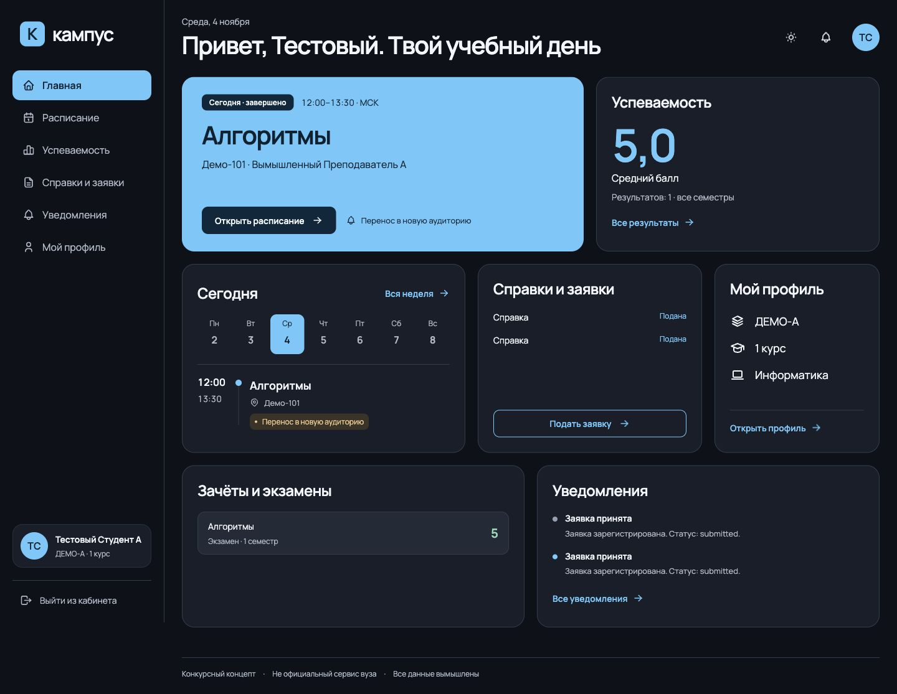
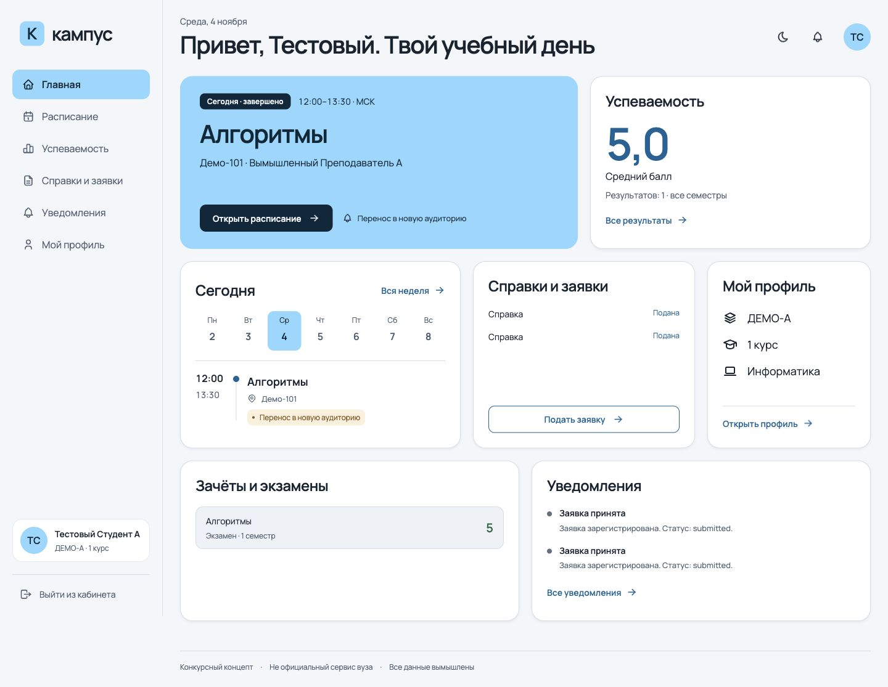
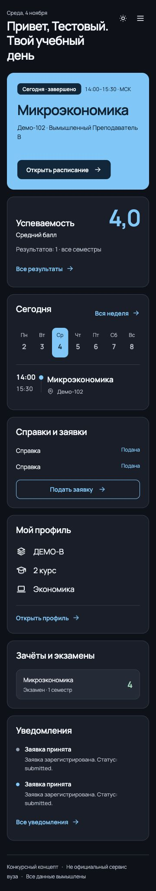

# Приёмка редизайна — 04.11.2026

Задачи [#4](https://github.com/skyzixss/AI-Hackathon-2026/issues/4) и
[#6](https://github.com/skyzixss/AI-Hackathon-2026/issues/6).
Проверен [PR #13](https://github.com/skyzixss/AI-Hackathon-2026/pull/13),
коммит edaa91dfb88b2ede38faed5c896544a91f916d32, поверх интеграции #12.
Приёмка подготовлена в отдельной ветке test/skyzixss-redesign-acceptance.
Исходники интерфейса участников, зависимости, API и SQL не изменялись.

## Результат review

В просмотренных изменениях нет найденных блокирующих ошибок. Проверены shell,
Dashboard, выбор занятия, переключение темы и её применение до первого
отображения, подключение модулей заявок/уведомлений и адаптивные стили.
Приватные экраны размонтируются при выходе; смена идентификатора студента
создаёт новый экземпляр кабинета; запоздалые результаты чтения игнорируются.
Данные главной читаются через общий SDK, серверные права не заменяются
локальными фильтрами и фикстурами.

Найден пробел автоматизации: общий npm test выбирал только errors.test.ts
из src/app/checks и пропускал три новых теста. Маска заменена на
src/app/checks/*.test.ts: теперь все 15 тестов запускаются общей командой
и будут выполняться существующим workflow. README и инструкции обновлены.
Эта проверка не является Approve от другого участника для нашего изменения.

## Выполненные проверки

- npm run check — успешно.
- npm test — 15/15.
- npm run build — успешно; проверено отсутствие admin-ключа и обоих паролей
  в итоговых файлах dist.
- npm run test:db — 66/66, изолированный настоящий PostgreSQL с тестовым auth.uid().
- npm run test:live — 55/55, настоящий Auth/REST выделенного демо-проекта.
- Браузер IAB — 44/44; [машинный протокол](redesign-acceptance/live-browser.json).
- git diff --check и локальные Markdown-ссылки — успешно.

Vite обращался непосредственно к настоящему Supabase. HTTP-фикстуры,
подмена SDK и локальное хранилище учебных данных не использовались.
В браузере созданы две вымышленные заявки (одна у A и одна у B); серверный
прогон также создаёт свои две тестовые заявки. Демо-данные не удалялись.
Секреты и пароли использованы только локально и не включены в отчёт.

## Что подтверждено в браузере

1440×1000 и 360×800: вход A/B, разные профили, расписания и оценки, перенос,
недельное расписание и выбор семестра; приветствие из текущего профиля.
Обе темы переключаются и сохраняются после перезагрузки. Все шесть разделов
проверены на 360 px в обеих темах без горизонтального переполнения.

Реальная заявка A сохраняется после reload и повторного входа. При её
создании количество уведомлений возрастает ровно на одно. Прочтение нового
уведомления сохраняется после reload. B не видит новую заявку A; его собственная
заявка сохраняется после reload и не появляется при повторном входе A.
Пустая заявка отклоняется без сообщения об успехе; неверный пароль оставляет
пользователя на входе. Выход скрывает личные данные, reload не открывает кабинет.

Escape закрывает мобильное меню и возвращает фокус на кнопку; выбор раздела
закрывает меню и фокусирует заголовок. Вход с клавиатуры Enter работает.
В собранных браузерных логах до намеренного неверного пароля нет ошибок
или предупреждений. Пометка конкурсного концепта видима.

## Ограничения и передача

Сайт не опубликован, новый CI для изменения списка тестов ещё не запускался.
Аппаратный телефон и скринридер не проверены. Новый live-прогон ошибки сети
в браузере не выполнялся; предыдущая неуспешная offline-эмуляция описана
в [integration.md](integration.md). 44 проверки не включают этот сценарий.
Автоматические проверки прав дополняют UI-прогон, но не означают полной
готовности сервиса для настоящих персональных данных.

Далее: опубликовать изменение тестов и этот отчёт отдельным PR к ветке #13,
получить review другого участника; после разрешения объединять #12 и затем
#13 с перенаправлением на main. Исходные #10/#11 повторно не объединять.
Публичное размещение требует отдельного поручения и проверки уже по его URL.

## Снимки реального демо

Только вымышленные данные облачных демо-студентов.

