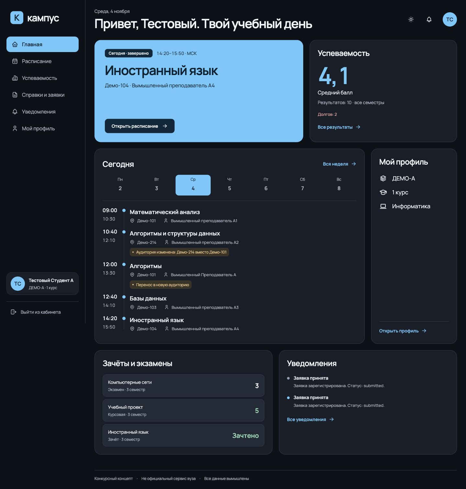
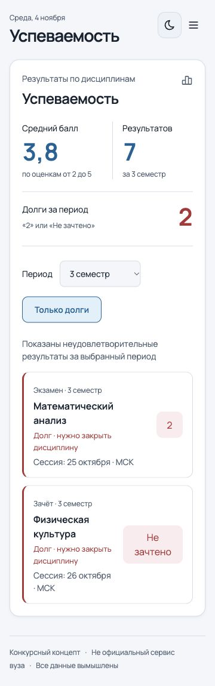
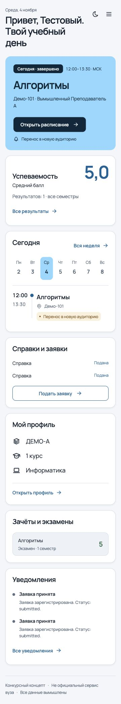

# Приёмка редизайна — 04.11.2026

Задачи [#4](https://github.com/skyzixss/AI-Hackathon-2026/issues/4) и
[#6](https://github.com/skyzixss/AI-Hackathon-2026/issues/6).
Проверен [PR #13](https://github.com/skyzixss/AI-Hackathon-2026/pull/13),
коммит edaa91dfb88b2ede38faed5c896544a91f916d32, поверх интеграции #12.
Приёмка подготовлена в отдельной ветке test/skyzixss-redesign-acceptance.
Исходники интерфейса участников, зависимости, API и SQL не изменялись.

## Результат review

В просмотренных изменениях нет найденных блокирующих ошибок. Проверены shell,
Dashboard, выбор занятия, переключение темы и её применение до первого
отображения, подключение модулей заявок/уведомлений и адаптивные стили.
Приватные экраны размонтируются при выходе; смена идентификатора студента
создаёт новый экземпляр кабинета; запоздалые результаты чтения игнорируются.
Данные главной читаются через общий SDK, серверные права не заменяются
локальными фильтрами и фикстурами.

Найден пробел автоматизации: общий npm test выбирал только errors.test.ts
из src/app/checks и пропускал три новых теста. Маска заменена на
src/app/checks/*.test.ts: теперь все 15 тестов запускаются общей командой
и будут выполняться существующим workflow. README и инструкции обновлены.
Эта проверка не является Approve от другого участника для нашего изменения.

## Выполненные проверки

- npm run check — успешно.
- npm test — 15/15.
- npm run build — успешно; проверено отсутствие admin-ключа и обоих паролей
  в итоговых файлах dist.
- npm run test:db — 66/66, изолированный настоящий PostgreSQL с тестовым auth.uid().
- npm run test:live — 55/55, настоящий Auth/REST выделенного демо-проекта.
- Браузер IAB — 44/44; [машинный протокол](redesign-acceptance/live-browser.json).
- git diff --check и локальные Markdown-ссылки — успешно.

Vite обращался непосредственно к настоящему Supabase. HTTP-фикстуры,
подмена SDK и локальное хранилище учебных данных не использовались.
В браузере созданы две вымышленные заявки (одна у A и одна у B); серверный
прогон также создаёт свои две тестовые заявки. Демо-данные не удалялись.
Секреты и пароли использованы только локально и не включены в отчёт.

## Что подтверждено в браузере

1440×1000 и 360×800: вход A/B, разные профили, расписания и оценки, перенос,
недельное расписание и выбор семестра; приветствие из текущего профиля.
Обе темы переключаются и сохраняются после перезагрузки. Все шесть разделов
проверены на 360 px в обеих темах без горизонтального переполнения.

Реальная заявка A сохраняется после reload и повторного входа. При её
создании количество уведомлений возрастает ровно на одно. Прочтение нового
уведомления сохраняется после reload. B не видит новую заявку A; его собственная
заявка сохраняется после reload и не появляется при повторном входе A.
Пустая заявка отклоняется без сообщения об успехе; неверный пароль оставляет
пользователя на входе. Выход скрывает личные данные, reload не открывает кабинет.

Escape закрывает мобильное меню и возвращает фокус на кнопку; выбор раздела
закрывает меню и фокусирует заголовок. Вход с клавиатуры Enter работает.
В собранных браузерных логах до намеренного неверного пароля нет ошибок
или предупреждений. Пометка конкурсного концепта видима.

## Ограничения и передача

Сайт не опубликован, новый CI для изменения списка тестов ещё не запускался.
Аппаратный телефон и скринридер не проверены. Новый live-прогон ошибки сети
в браузере не выполнялся; предыдущая неуспешная offline-эмуляция описана
в [integration.md](integration.md). 44 проверки не включают этот сценарий.
Автоматические проверки прав дополняют UI-прогон, но не означают полной
готовности сервиса для настоящих персональных данных.

Далее: опубликовать изменение тестов и этот отчёт отдельным PR к ветке #13,
получить review другого участника; после разрешения объединять #12 и затем
#13 с перенаправлением на main. Исходные #10/#11 повторно не объединять.
Публичное размещение требует отдельного поручения и проверки уже по его URL.

## Допроверка обновления 4a1055d

После первоначальной приёмки Артём добавил 5c1db35 и 4a1055d: убрал карточку
заявок с главной, расширил расписание и показ преподавателя, выделил текущую
дату рамкой со всех сторон. Новая версия включена в локальную ветку проверки
обычным merge, ветка Артёма не изменялась.

Повторно прошли TypeScript, все 15 unit-тестов и production build.
Выполнены ещё 11 целевых браузерных проверок с настоящим Supabase:
1440/1069/360 px, обе темы на 1069/360 px, смена дня и пустое расписание,
рамка текущего дня, переход в отдельный раздел заявок и сохранность ранее
созданной заявки A. Блокирующих ошибок в этом diff не найдено.
Облачные 55 и локальные 66 серверных проверок не повторялись: API, SQL и
авторизация не менялись. Первые 44 проверки и четыре снимка ниже относятся
к edaa91d; они не выдаются за повторный полный прогон нового diff.

[Протокол допроверки](redesign-acceptance/update-4a1055d.json) ·
[Обновлённая мобильная главная](redesign-acceptance/expanded-schedule-mobile.png).

## Review расширенного демо e188e36

Изучены scripts/demo-data.ts, refresh-demo.ts, изменения seed-demo.ts и
модель результатов учёбы. Модуль генератора не импортируется приложением.
Обновление существующих аккаунтов заранее проверяет наличие обоих пользователей
и профилей, требует явного разрешающего флага. Пароли и профили не меняются;
расписание и оценки обновляются по стабильным ID; для заявок и уведомлений
используется ignoreDuplicates, чтобы сохранить статус и прочтение. Строки
не удаляются, старые демо-занятия/оценки сохранятся рядом с новыми примерами.
Запись не является одной общей транзакцией: при частичном отказе нужен
повтор после устранения причины. Идемпотентность покрыта тестовым HTTP-стендом,
а не реальным облачным запуском.

TypeScript, production build и общий npm test (20/20) прошли. Шесть целевых
браузерных проверок с существующими облачными данными подтвердили счётчик
без долгов, пустой фильтр, выбор семестра, возврат оценки и 360 px в обеих
темах: [протокол](redesign-acceptance/update-e188e36.json),
[снимок](redesign-acceptance/debt-filter-current-cloud.png).
Новые примеры отрицательных оценок в облаке пока отсутствуют; их live-приёмка
не заявляется. Логика отрицательных результатов проверена unit-тестами.

Read-only preflight выделенного проекта jbzaqvutbybrhjctrexc подтвердил
два существующих аккаунта и профиля. На момент проверки: 2 занятия, 2 оценки,
14 заявок и 16 уведомлений; записи этой проверкой не выполнялись.
Перед live-приёмкой нового наполнения требуется разрешение пользователя
на запуск scripts/refresh-demo.ts в этом демо-проекте. Он подготовит
28 занятий, 18 результатов, 4 примера истории заявок и 6 новостей;
триггер дополнительно создаст уведомления о первичной вставке примеров заявок.
Повторный запуск сохраняет существующие статусы/прочтение. Публикация ветки,
merge и облачное обновление в этой проверке не выполнялись.

## Облачное обновление по разрешению пользователя

04.11.2026 пользователь разрешил применить расширенное вымышленное наполнение
в student-portal-hackathon. До записи проверен точный ref jbzaqvutbybrhjctrexc;
снимок прежних строк сохранён только в ignored work/. Запущен проверенный
scripts/refresh-demo.ts из e188e36, затем выполнен повторный запуск.
Первое применение добавило 28 занятий, 18 результатов, 4 примера заявок,
6 новостей и 4 служебных уведомления триггера. Повторное применение ничего
не добавило и не изменило. Все прежние строки пяти таблиц и профили остались
равны снимку; локальный файл паролей не менялся, оба прежних пароля работают.

[Машинный отчёт обновления](redesign-acceptance/cloud-demo-refresh.json):
после обновления 30 занятий, 20 результатов, 18 заявок и 26 уведомлений
на два аккаунта. Следующий прогон Auth/REST создал ещё две тестовые заявки
и два уведомления; эти количества относятся к моменту сразу после refresh.
Старые строки не удалялись: в среду на главной пять занятий, а не четыре;
результатов на студента десять, а не девять. Это сохранённые данные первого seed.

Повторный npm run test:live прошёл 55/55: вход старым паролем, изоляция
в обе стороны и прямой доступ, запрет подмены owner/status, сохранение
заявок и отзыв refresh-сессии после выхода. SQL, права и Auth settings
этим обновлением не менялись.

В браузере прошли ещё 17 целевых проверок с настоящим Supabase
([протокол](redesign-acceptance/enriched-cloud-browser.json)):
у A два долга, фильтр и переключение семестров; у B долгов нет и чужие
результаты отсутствуют. У обоих доступны свои старые заявки и новая история,
у A видны Готово/На рассмотрении/Отклонена; новые новости разделены по аккаунтам.
360 px в обеих темах и 1440 px без обнаруженного переполнения.
Пароли, токены и admin-ключ не включены в отчёты и снимки.
Публичного размещения и merge по-прежнему нет.

## Снимки первоначальной приёмки

Только вымышленные данные облачных демо-студентов.

