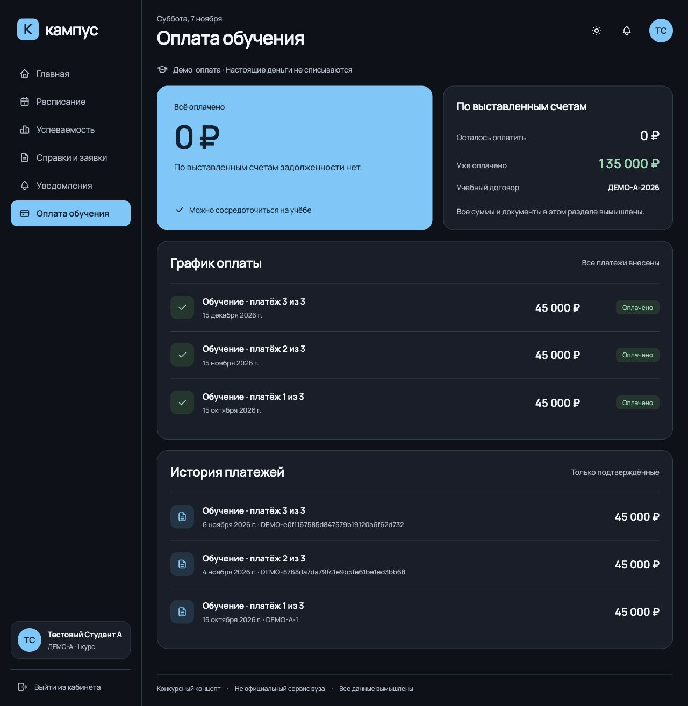
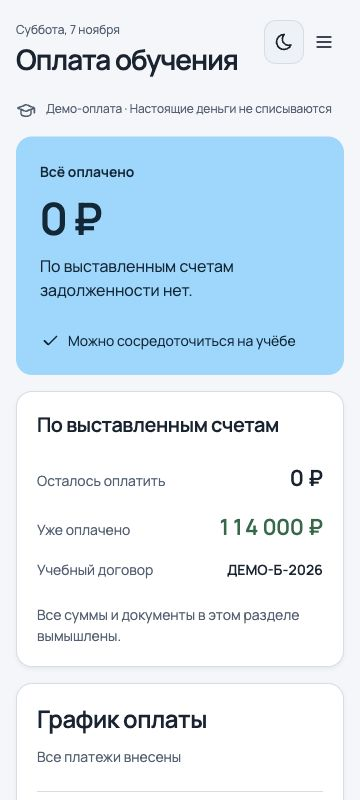

# Публичный выпуск — 07.11.2026

[Открыть «Кампус»](https://student-portal-hackathon.ankajournal-cloudflare.workers.dev/#payments).
По поручению пользователя после независимого review объединены
[PR #23](https://github.com/skyzixss/AI-Hackathon-2026/pull/23) — условия сдачи —
и [PR #24](https://github.com/skyzixss/AI-Hackathon-2026/pull/24) — списки оплаты.
Squash-коммиты `cbb76bc9761df158dac7e6e124005b58dfd13249` и
`11f4bb7bc1fa93cd54d6629f9796a5456d57d25b`; исходные ветки удалены.

Опубликован main `11f4bb7bc1fa93cd54d6629f9796a5456d57d25b`.
Worker `student-portal-hackathon`, версия
`c7955517-51c9-458c-b5f8-c4465855a610`, 100% трафика,
создана 07.11.2026 в 10:14 UTC. Адрес и настройки сохранены;
Supabase, Auth, миграции, пароли и демо-данные этим выпуском не менялись.

График начинается с наиболее позднего срока; сначала максимум три строки.
Остальные раскрываются кнопкой «Показать больше». Баланс и ближайший платёж
учитывают все строки. История остаётся полной, последние фактические оплаты
идут первыми. [Поведение и локальные проверки](../tuition.md).

## Проверки выпуска

- Review #24 относится к точному head `87a5e7255b3306f634bae37dfe17cc82826fe3f5`.
  Независимо прошли TypeScript, 33 теста, build и 9 браузерных проверок с
  локальными HTTP-фикстурами: шесть счетов, preview/Enter/aria-expanded,
  открытие и отмена скрытого старого счёта, баланс всего набора, сворачивание,
  360 px. Это не проверка облачных данных.
- Итоговый main совпадает по исходникам продукта с проверенным #24.
  [CI main](https://github.com/skyzixss/AI-Hackathon-2026/actions/runs/42362966522)
  успешен: TypeScript, 33 клиентских теста, build, PostgreSQL/RLS.
- Production build и Wrangler dry-run прошли. Перед публикацией проверено
  отсутствие приватных ключей и демо-паролей в dist. Известное предупреждение:
  JS немного больше 500 kB; сборка успешна.
- После публикации HTML, JS, CSS и шрифт скачаны по HTTPS и побайтно совпали
  с dist; SPA fallback `/demo-route` совпал с index.
  [Версия, размеры и SHA-256](2026-11-07-assets.json).
- **17/17 проверок**: [публичный браузерный протокол](2026-11-07-browser.json): настоящий HTTPS
  сайт и Supabase, без HTTP-фикстур. Вход/выход A/B, свои договоры и суммы,
  обратный порядок трёх счетов, полная история, повторный вход и reload,
  мобильный профиль B, 360 px в двух темах без горизонтального переполнения.

## Актуальные данные и ограничения

На момент проверки у **A уже все три счёта оплачены**: 135 000 ₽, остаток 0 ₽;
последняя оплата в истории датирована 06.11.2026. У B — 114 000 ₽, остаток 0 ₽.
Это состояние прочитано с сервера до теста; новые платежи, заявки и отметки
прочтения не отправлялись, история не сбрасывалась. Старые отчёты о неоплаченном
счёте A описывают прошлое состояние.

В облаке по три счёта, поэтому раскрытие списка не возникает; эта ветка поведения
проверена локально на шести строках до merge. Для демонстрации подтверждения
оплаты потребуется отдельное согласованное вымышленное пополнение, его здесь нет.
Сетевой отказ/истечение сессии на публичном origin повторно не воспроизводились;
физический телефон и скринридер этим выпуском не проверялись.

Предыдущая версия для возможного отката:
`d8ef30ee-6338-4d31-91fe-e1baf4c98b8a` (06.11.2026, source `6a05a1b`).
Её документационный [PR #22](https://github.com/skyzixss/AI-Hackathon-2026/pull/22)
ждёт повторного review исправленного снимка `f173f83`; отчёт текущего выпуска
вынесен в отдельные файлы, чтобы не пересекаться с ним. Откат фронтенда
не откатывает Supabase и историю платежей.

Материалы других агентов для итогового PDF ещё не поступили; рабочий PDF не
выдаётся за полный конкурсный комплект. Форма сдачи открывается 08.11.2026
в 19:00 МСК, её поля до открытия не подтверждены; отправка не выполнялась.
[Условия и открытые вопросы](../contest-submission.md).

