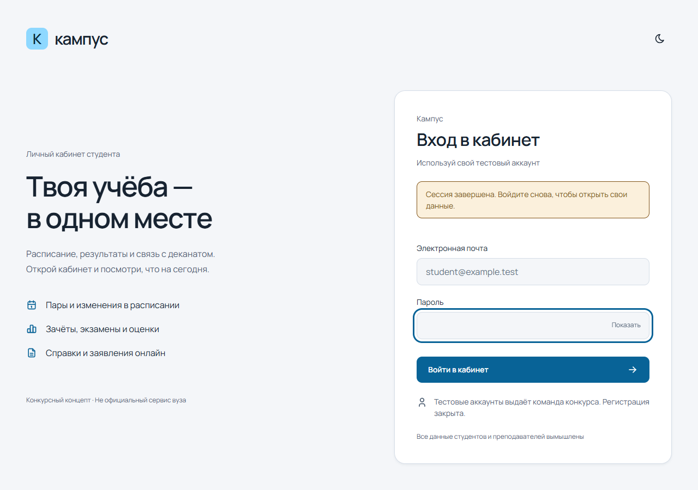
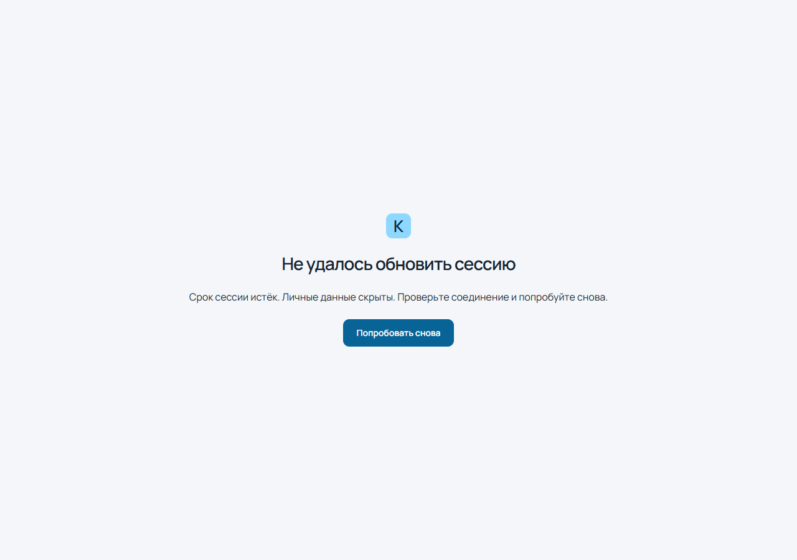
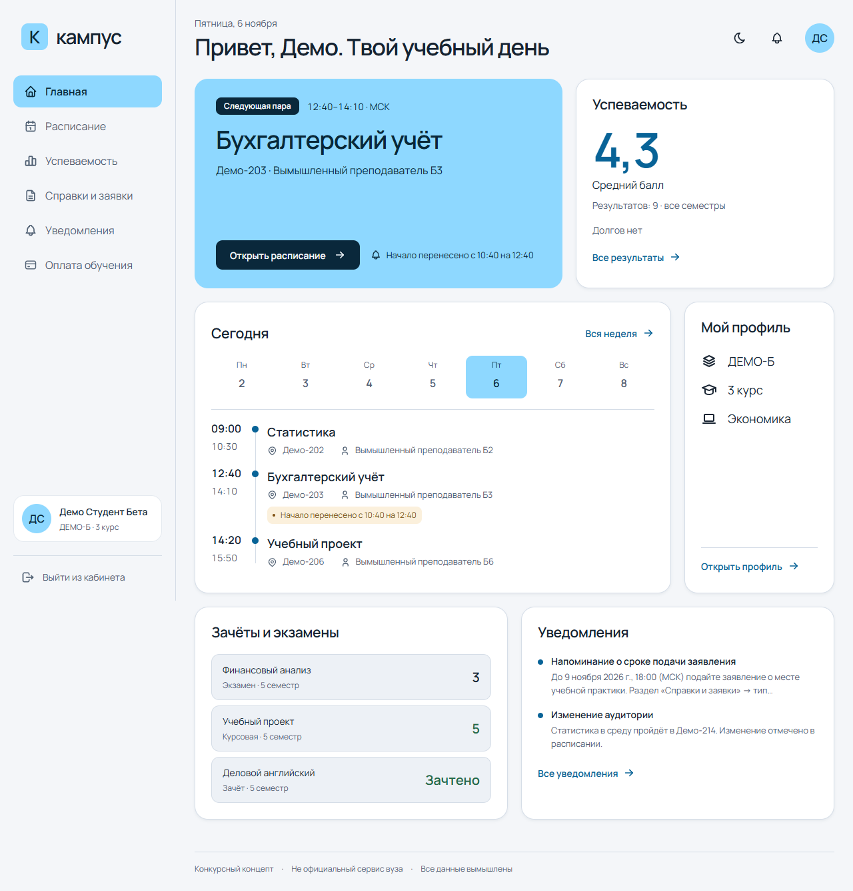
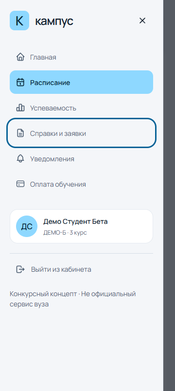
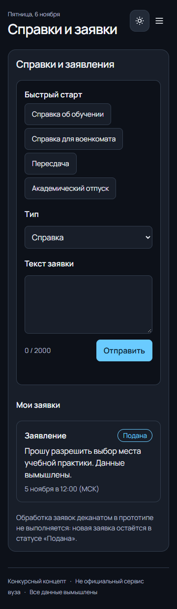
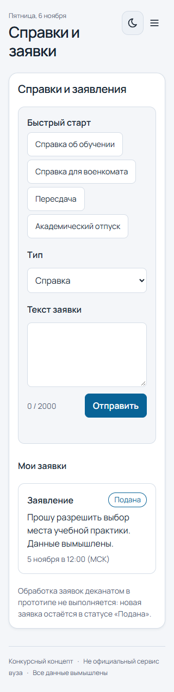

# Истечение сессии и доступность — 06.11.2026

При проверке main d363c03 найден и исправлен P2: после истечения access token
временный отказ refresh (503) оставлял на экране уже загруженный профиль без
предупреждения. SDK сохраняет сессию для повторной попытки, а оболочка слушала
только события Auth. Это проблема отображения кэша своего студента; новый
обход серверного RLS или чтение чужих данных этим прогоном не обнаружены.

Оболочка теперь отслеживает фактический expires_at, включая возвращение во
вкладку, скрывает личные экраны и показывает восстановление. Предупреждение
получает фокус. TOKEN_REFRESHED возвращает кабинет; старый таймер не может
прервать новую сессию. Преждевременный отказ refresh при ещё действующем
access token не завершает допустимую сессию.

## Среда и доказательства

Настоящие React DOM и Supabase SDK в отдельном Chrome 156.0.8078.80,
Playwright 1.57; только локальные HTTP-фикстуры с вымышленными A/B и
управляемыми часами. Отдельный Chrome разрешён пользователем после сбоя
встроенного браузера. Профиль, вкладки и учётные записи пользователя не
использовались. Облачных записей, миграций и публикации сайта не было.

Основа — main d363c03524fc14fb11d874cb169393387b0e068f плюс исправление этого PR.
Протоколы содержат SHA256 проверенного App.tsx с нормализованными LF.
Снимки ниже сделаны и просмотрены в текущем прогоне; исторические отчёты
предыдущих выпусков не заменялись.

Новая регрессия actual-source/hooks сначала воспроизвела ошибку на старой
оболочке, после исправления прошла. Полный набор: **32 теста**, TypeScript и
production build прошли. Это отдельные проверки от браузерного прогона.
Известное предупреждение сборки — JS чуть более 500 kB. SQL/RLS не менялись,
новый локальный PostgreSQL или облачный Auth/REST прогон не запускались.

[10 воспроизводимых браузерных проверок сессии](session-a11y/session-browser.json) ·
[Ручной браузерный проход и матрица экранов](session-a11y/accessibility-browser.json).
Их пересекающиеся сценарии не складываются в число уникальных проверок.

## Шаги проверки

1. **Вход и окончательный отказ — исправно.** Проверены подписи полей,
   переход email → пароль клавишей Tab; при окончательном 400 после истечения
   сессии SDK удаляет её, личные экраны исчезают, показан повторный вход.
   Другой студент входит со своим профилем без предыдущего.

   

2. **Временный отказ при истёкшем токене — исправлено.** Настоящий refresh
   запрос к HTTP-фикстуре получил 503. Профиль скрыт, видны объяснение и
   повтор; фокус находится на заголовке. SDK продолжает штатное восстановление.

   

3. **Восстановление — исправно.** После успешного refresh возвращаются
   собственные данные Б. Старый срок не скрывает обновлённую сессию.
   Отдельно проверены здоровое обновление и отказ преждевременного обновления.

   

4. **Клавиатура и мобильное меню — исправно в проверенных сценариях.**
   Ссылка пропуска фокусирует main, переход по разделу — заголовок; Enter
   открывает меню, Escape закрывает его и возвращает фокус. 16 нажатий Tab
   не передают фокус фоновым элементам. Native dialog допускает краткий выход
   фокуса в интерфейс Chrome (document.hasFocus=false); это отдельно записано
   в протоколе и не объявлено попаданием в фон страницы.

   

5. **Форма и перестроение — исправно в проверенной матрице.** Ошибка пустой
   заявки связана с textarea через aria-describedby, aria-invalid=true,
   текст помещён в aria-live=polite. Проверены семь разделов на 320 и 640 CSS px
   в двух темах: 28 сочетаний без горизонтального переполнения и выхода
   проверенных элементов формы за экран. Отдельно просмотрен экран 360 px.
   Reduced motion отключает анимацию раздела. Измеренные 10 пар основных
   цветовых токенов имеют контраст от 5,6:1; это не проверка каждого пикселя.

   
   

6. **Поля конкурсной формы — не проверены.** Переход отдельного браузера на
   https://challenge.mgimo.ai/login завершился сетевым timeout 20 секунд.
   Публичная страница входа ранее доступна через веб-проверку; авторизованного
   кабинета капитана в тестовом профиле нет. Логины/пароли не вводились,
   сброс пароля, регистрация и подача работы не выполнялись.

## Повторить сценарий сессии

Нужен уже установленный Playwright, доступный Chrome и локальный Vite.
Новые зависимости в проект этим PR не добавлены. В отдельном терминале
запустить Vite с фиктивной конфигурацией, которая перехватывается тестом:

```powershell
$env:VITE_SUPABASE_URL='http://127.0.0.1:54331'
$env:VITE_SUPABASE_PUBLISHABLE_KEY='sb_publishable_audit_only'
npm run dev -- --host 127.0.0.1 --port 5174 --strictPort
```

В другом терминале задать PLAYWRIGHT_MODULE_PATH полным путём к index.mjs
уже установленного Playwright (или использовать его обычное разрешение
модулей) и при необходимости CHROME_PATH. Затем:

```powershell
node --experimental-strip-types src/app/checks/session-browser.mjs
```

Скрипт разрешает только loopback UI_BASE_URL, использует локальный поддельный
backend, сохраняет результат в ignored work/session-browser-check/. Это не
команда проверки настоящего Supabase и не конфигурация для публикации.

## Оставшиеся ограничения и следующий этап

- Физический телефон и реальный сеанс со скринридером не проверены.
  Клавиатура, DOM-подписи и aria-live не заменяют чтение настоящим AT.
- Проверено перестроение на 320/640 CSS px, а не настройка нативного zoom
  Chrome; полное соответствие WCAG этим отчётом не заявляется.
- Принудительный отказ refresh проверен на настоящем SDK и интерфейсе,
  но с HTTP-фикстурами. Повтор на публичном origin остаётся отдельным этапом.
- Для полей сдачи агенту капитана нужен доступ к его авторизованной форме:
  прочитать требования к ссылке/архиву, форматам и размерам файлов, видео,
  промптам и передаче тестовых доступов. Финальную отправку не выполнять
  без отдельного поручения. Пароли не переносить в GitHub.
- Исправление требует review другого участника, затем принятия и отдельного
  выпуска. Публичный продукт этой проверкой не обновлён.

Отдельного Issue нет: прямое поручение пользователя продолжить пункты
плана после интеграции #17/#19/#20. Изменены оболочка и проверки её области;
серверная схема, контракты и зависимости сохранены.
