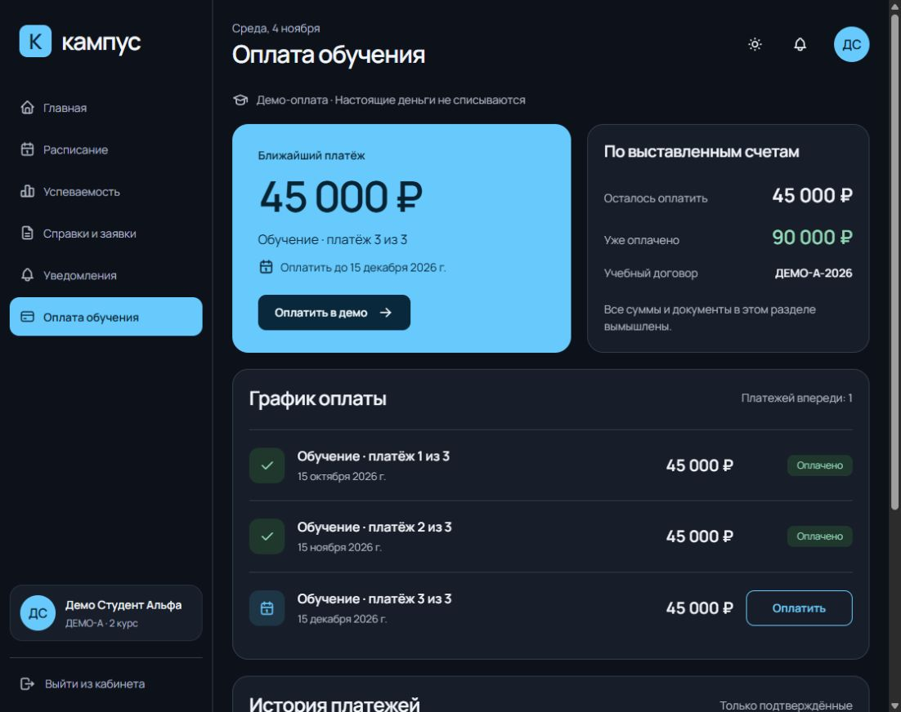
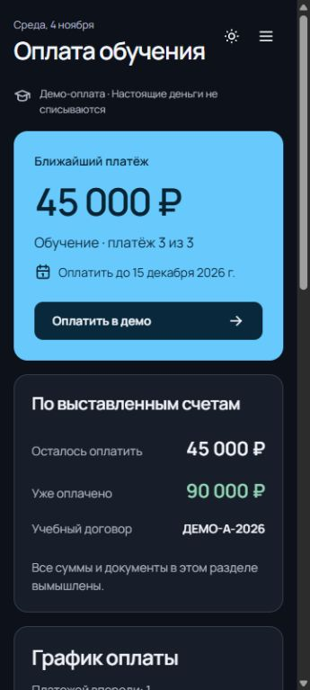
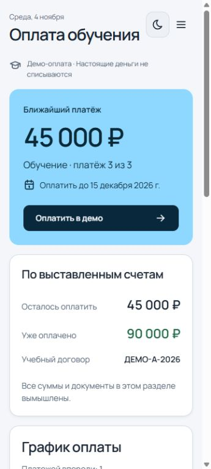

# Оплата обучения

Прямое поручение пользователя: заменить пункт меню «Мой профиль» на «Оплата
обучения». Сам профиль остаётся по #profile, через аватар, карточку студента
и ссылку на главной. На телефоне карточка находится под основными пунктами меню.
Отдельного Issue на дополнительный раздел пока нет; это расширение UI задачи #6.

## Поведение

Ближайший платёж, остаток по выставленным счетам, оплаченная сумма, номер
вымышленного договора, график и история. Прошедший срок выделяется текстом.
Нулевой остаток, отсутствие счетов, загрузка и ошибка имеют отдельные состояния.
Подтверждение открывается в нативном dialog с Escape/возвратом фокуса.
Во время записи повторное подтверждение заблокировано; после подтверждённого
ответа обновляются суммы и история. Ошибка не превращается в успех.

**Только демонстрационная оплата.** Это помечено в разделе, на кнопке и в окне
подтверждения. Карточные данные, СБП, реальные реквизиты и платёжный провайдер
не используются. «Подтверждение DEMO-…» не является банковским документом.

Обе темы и переход раздела 280 мс сохранены. При reduced motion анимации
отключаются общим правилом. Новая иконка tuition-card.svg нарисована для проекта;
зависимости не добавлены.

## Дополнительный контракт для review владельцем #4

Модуль изолирован в src/features/payments. Общие src/api/portal.ts, SQL-миграции,
пакеты и чужие компоненты не изменены. createTuitionApi получает **тот же**
Supabase-клиент из src/app/client.ts; отдельного Auth/хранилища сессий нет.

- charges(): tuition_charges[], чтение по RLS, сортировка due_on.
- payDemo(chargeId): RPC complete_demo_tuition_payment({charge_id}), один
  подтверждённый счёт. Клиент не передаёт сумму, владельца и новый статус.
- Поля: id, student_id, title, contract_number, amount_kopecks (целое число),
  due_on (дата), paid_at (ISO|null), payment_reference (строка|null), demo_only.
- UI дополнительно отклоняет ответ с другим student_id. Данные удаляются из
  интерфейса вместе с оболочкой при выходе/смене аккаунта; поздние ответы игнорируются.

Предложение схемы: [backend/tuition.sql](../src/features/payments/backend/tuition.sql).
Студенту разрешено только SELECT своих строк; INSERT/UPDATE/DELETE запрещены.
RPC проверяет auth.uid(), принадлежность и demo_only, блокирует строку до записи
и при повторе возвращает прежнее подтверждение. Анонимам выполнение запрещено.
Чужой и несуществующий id дают одинаковую ошибку. Вся таблица допускает лишь
demo_only=true: подключать этот RPC к настоящим счетам нельзя.

Схема подготовлена отдельным файлом **для согласования #4**, не помещена в общую
цепочку миграций и не применена в облаке. До подключения таблицы облачный раздел
покажет ошибку с повтором, а не вымышленные счета. Не считать это live-приёмкой.
Следующий шаг агента #4: review контракта/SQL, проверка в новой изолированной БД,
затем перенос схемы в новую миграцию и подключение только выделенного демо-проекта.

## Данные и подключение демо

backend/demo-data.ts используется только административным скриптом и отдельным
локальным HTTP-стендом. В браузерный import-граф он не входит. У A три счёта
по 45 000 ₽: один оплачен, два предстоящих. У B три по 38 000 ₽, все оплачены
заранее. Идентификаторы зависят от студента и номера платежа; даты при первом
seed привязаны к текущему московскому месяцу. При повторном seed существующие
строки и подтверждения не меняются.

После review и применения схемы агентом #4, с уже существующими A/B и server-only
конфигурацией в ignored .env:

```sh
node --env-file=.env --experimental-strip-types src/features/payments/backend/seed.ts
```

Нужны SUPABASE_URL, SUPABASE_SECRET_KEY и явный PORTAL_ALLOW_DEMO_SEED=yes.
До записи проверяется наличие обоих аккаунтов и профилей; Auth, пароли,
старые счета и остальные таблицы не изменяются. Запуск здесь не выполнялся.
Привилегированные переменные не добавлять в VITE_ и не публиковать в GitHub.

## Проверки

Типы и build прошли. npm test: 19/19; три дополнительных уникальных теста
dashboard/theme также прошли (22 уникальных теста всего). Новые тесты проверяют
суммы в копейках, границу просрочки, полностью оплаченный/пустой набор,
разделение генератора A/B, контракт настоящего SDK, отказ при неподтверждённом
ответе и ошибке сервера. В RPC уходит только charge_id.

В IAB с отдельным HTTP-стендом проверены:

- Удаление пункта профиля на desktop и в мобильной навигации; профиль через карточку.
- Ближайший счёт, суммы и история A; ошибка оплаты без успеха; блокировка кнопки
  во время записи; успешный ответ, обновление остатка и фокус на подтверждении.
- Сохранение истории после reload и повторного входа; Escape/отмена с возвратом фокуса.
- Ошибка загрузки с повтором, пустой набор, скрытие ошибочно возвращённых чужих строк.
- 360 px, обе темы, отсутствие горизонтальной прокрутки, мобильное окно и меню.
- B: свой договор, нулевой остаток, три подтверждения, нет данных A; возврат к A.
- Отсутствие полей ввода банковских данных.

Это UI/SDK-проверки, **не доказательство облачного RLS**. PostgreSQL и WSL
здесь отсутствуют. Для #4 подготовлен [backend/check-rls.mjs](../src/features/payments/backend/check-rls.mjs):
он принимает только TEST_PG_SOCKET новой пустой локальной БД, применяет foundation
и предложение tuition.sql, проверяет обе стороны изоляции, прямую подмену
суммы/статуса, анонимов, отсутствующий id и одновременное повторное подтверждение.
Скрипт прошёл проверку синтаксиса, но **не запускался с PostgreSQL**.
Обычный test:db пока не включает это отдельное предложение схемы.




