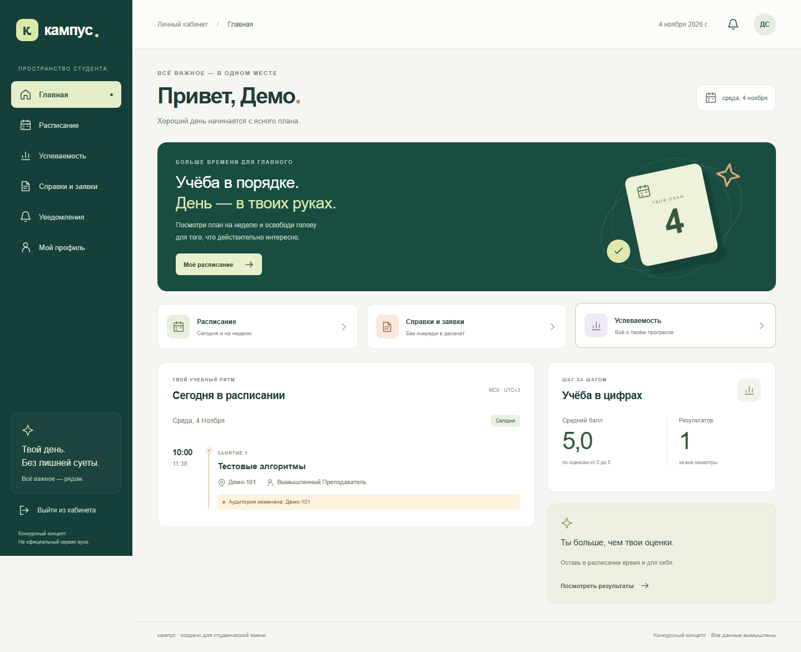
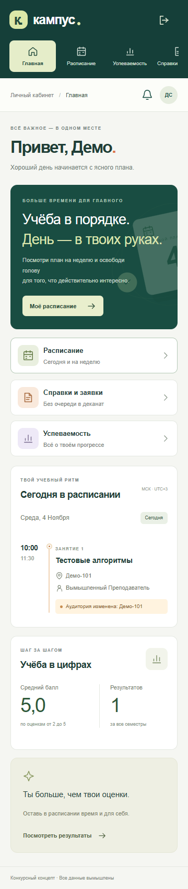

# Интерфейс студента — задача #6

Ветка: `feat/artem-student-ui`. Вход/выход, главная, профиль, расписание
сегодня/неделя с выбором даты, переносы, оценки, семестры и сведения о сессии.
Реальные данные читаются через общий `portalApi`; в приложении нет моков или
локального хранилища оценок. Сессией управляет общий Supabase-клиент.

## Запуск

```sh
npm ci
```

В ignored `.env` задайте `VITE_SUPABASE_URL` и
`VITE_SUPABASE_PUBLISHABLE_KEY` для выделенного демо-проекта. Привилегированные
ключи и пароли здесь не нужны. При отсутствии конфигурации вход отключён,
показывается состояние недоступного сервиса.

```sh
npx vite
npx vite build
npx vite preview
```

Команды scripts dev/build/preview запрошены у владельца общих файлов в Issue #4;
package.json и lock-файл эта задача не меняет. Новый код не требует зависимостей.

## Проверки

```sh
npm run check
npm test
node --experimental-strip-types --test src/features/studies/dates.test.ts
node --experimental-strip-types --test src/app/checks/errors.test.ts
git diff --check
```

Даты отображаются в Europe/Moscow. Отдельные тесты проверяют UTC-границы дня,
неделю с понедельника и переход года; нельзя вычислять их в локальном поясе ПК.

### Изолированная браузерная проверка

Это проверка UI с настоящим Supabase SDK и HTTP-фикстурами в Playwright,
не проверка облачного Supabase или его RLS. Фикстуры не входят в сборку.
Используются вымышленные аккаунты и данные, не связанные с облачными студентами.

Для инструментов проверки можно использовать отдельную ignored папку:

```sh
npm install --prefix work/ui-check --no-save --ignore-scripts playwright
```

В отдельном PowerShell запустите тестовый сервер:

```powershell
$env:VITE_SUPABASE_URL = 'https://portal-test.invalid'
$env:VITE_SUPABASE_PUBLISHABLE_KEY = 'sb_publishable_ui_test_only'
npx vite --host 127.0.0.1 --port 5173 --strictPort
```

В другом PowerShell:

```powershell
$env:PLAYWRIGHT_MODULE_PATH = 'work/ui-check/node_modules/playwright/index.mjs'
$env:CHROME_PATH = 'C:/Program Files/Google/Chrome/Application/chrome.exe'
node src/app/checks/browser.mjs
```

Путь Chrome можно заменить. Скрипт проверяет 1440 и 360 px, неверный пароль,
профиль, расписание/перенос, неделю, пустое состояние, истёкшую сессию, ошибку и повтор загрузки
оценок, семестр, смену A→B с задержанным ответом A, восстановление сессии после
перезагрузки, выход из другой вкладки, клавиатуру/skip-link и скрытие данных при неудачном выходе.
Снимки сохраняются в `work/ui-check/screenshots/`.

Перед реальным показом выключите сервер фикстур и запускайте с конфигурацией
демо-проекта. Проверьте тот же сценарий с двумя настоящими демо-аккаунтами;
не выдавайте результаты изолированного теста за облачную приёмку.

## Интеграция задачи #5

`src/app/extensions.tsx` обнаруживает компоненты из согласованных путей:

- `src/features/requests/RequestsPanel.tsx`: `api`, `sessionKey`, `onSubmitted`;
- `src/features/notifications/NotificationsPanel.tsx`: `api`, `sessionKey`, `refreshKey`.

После интеграции этих файлов они включатся в сборку без изменения shell.
До интеграции разделы честно показывают, что модуль ещё не подключён.
При подаче заявки увеличивается refreshKey; при смене студента весь кабинет
размонтируется. Владельцу #5 переданы сигнатуры в Issue. Его файлы не копировались.

## Безопасность и материалы

При выходе личные экраны скрываются немедленно, даже при сетевой ошибке.
При смене студента старые данные размонтируются, запоздалые запросы игнорируются.
Это дополняет серверный RLS, но не заменяет его. Регистрация в UI отсутствует.
При 401/403 показано сообщение о сессии/ограничении доступа.

Логотип «к.», SVG-пиктограммы и CSS-иллюстрации созданы в рамках задачи;
официальные знаки вузов, внешние изображения и веб-шрифты не используются.
Используется системный шрифт. React/Vite/Supabase — существующие зависимости
репозитория; их лицензии поставляются с пакетами.

## Снимки изолированного стенда

На снимках только HTTP-фикстуры, это не результат live-подключения.




